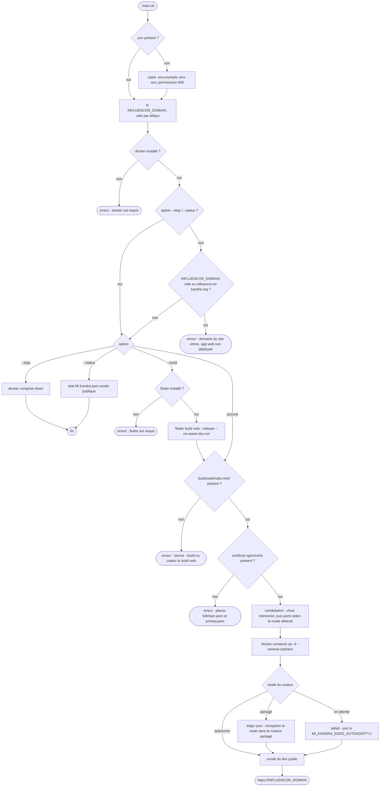

# `start.sh` — étapes et commandes

[← Documentation développeur](../README.md)

`start.sh` publie la version **web** d'Influencor (`build/web`) sur un serveur Mi Kandra : il démarre un nginx Docker qui sert le site et le fait cohabiter avec les autres stacks du serveur. Il ne construit ni l'application Android ni l'installateur Windows : voir [Builds](../build/builds.md).

> **Retirée de `influencor.mi-kandra.org`.** Ce domaine sert désormais le site vitrine et
> les téléchargements (dépôt [`influencor-web`](https://github.com/MorlonDev261/influencor-web)).
> L'app web Flutter n'est plus déployée par défaut : `start.sh` refuse de démarrer tant que
> `INFLUENCOR_DOMAIN` est vide ou vaut `influencor.mi-kandra.org`. Sur un serveur où elle
> tourne encore : `./start.sh --stop`, puis lancer `influencor-web`.

Le contexte (domaine, ports, fichiers) est décrit dans [Web : app Flutter](./web-mi-kandra.md).

## Ce que fait `./start.sh`

Modes de cohabitation, détectés par `scripts/edge/mi-kandra-edge.sh` :

| Mode | Situation |
|---|---|
| Autonome | Les ports 80 et 443 sont libres : le nginx d'Influencor les publie lui-même. |
| Partagé | Un routeur Mi Kandra est actif : Influencor s'y enregistre, sans conflit de ports. |
| En attente | 80/443 sont pris par un voisin non converti : lancer `adopt` pour le convertir. |
| Isolé | Choix « autonome » alors que 80/443 sont pris : loopback seulement, rien n'est converti. |

## Commandes

| Commande | Description |
|---|---|
| `./start.sh` | Démarre nginx, qui sert `build/web`, et cohabite avec les autres stacks. Exige un `build/web` existant. |
| `./start.sh --build` | Construit d'abord le site (`flutter build web --release --no-wasm-dry-run`), puis démarre. |
| `./start.sh --stop` | Arrête le conteneur (`docker compose down`). |
| `./start.sh --status` | État Mi Kandra (mode, routes) puis sonde du lien public. |

Toute autre option est refusée (`option inconnue`). Il n'y a pas d'option `--help` : l'en-tête du script fait office d'aide.

## Sous-commandes du routeur (`scripts/edge/mi-kandra-edge.sh`)

Ce script est **identique dans tous les projets Mi Kandra** (poma-original, mga-follow-up-v1, ArTest, Influencor). `start.sh` en appelle `choose`, `env`, `status`, `sync` et `adopt`.

| Sous-commande | Description |
|---|---|
| `env` | Affiche les `export` de ports de publication selon le mode détecté, à injecter avant `docker compose`. |
| `status` | État du routeur, des origins détectés et des routes. |
| `sync` | (Ré)enregistre dans le routeur tous les origins en marche. |
| `register` | Idem, limité au projet courant. |
| `unregister <projet>` | Retire les routes d'un projet. |
| `ensure-edge` | Démarre le routeur d'entrée (nécessite 80/443 libres). |
| `adopt [--yes] [--pull]` | Convertit les voisins qui publient déjà 80/443, démarre le routeur puis synchronise (coupure de quelques secondes). `--pull` met d'abord à jour les voisins trop anciens. |
| `choose` | Premier démarrage : demande comment cohabiter (cohabiter, autonome, plus tard) et mémorise le choix. `--reset` repose la question. |
| `doctor [--probe]` | Diagnostic complet ; `--probe` sonde chaque domaine en HTTPS et l'expiration du certificat. |

La sonde du lien public utilise `scripts/edge/mi-kandra-dns.sh probe <domaine>`.

## Fichiers liés

| Fichier | Rôle |
|---|---|
| `start.sh` | Orchestrateur décrit ci-dessus. |
| `docker-compose.yml` | nginx durci, labels `org.mi-kandra.*`. |
| `nginx/templates/influencor.conf.template` | Vhost (HTTP vers HTTPS, cache, repli SPA). |
| `nginx/certs/` | `fullchain.pem` et `privkey.pem` (jamais versionnés). |
| `scripts/edge/` | Routeur partagé, sonde DNS, sauvegardes ; seul `project.env` diffère entre projets. |
| `.env.example` | `INFLUENCOR_DOMAIN` (vide par défaut), chemins des certificats. |
